> **2026-11-12 제출 보강:** [보안·성능 변경과 검증 범위](docs/SUBMISSION_SECURITY_20261112.md). 앱 v0.321 / 코드 8. 아래 v0.32 영상은 이전 시연 증거입니다. 새 소스의 운영 적용·실기기 검증과 구분하세요.

<div align="center">
  
  <h1>01BO · 출장의 시작부터 일보 발송까지</h1>
  <p>일정 · 장소 검색 · GPS/NFC 현장 확인 · 경비 · 제로보 · Word · Gmail</p>
  <p><strong>Android 실기기 시연 버전 v0.32</strong> · React + TypeScript + Capacitor</p>
  <p><a href="https://github.com/hangjin01/01BO_Server">백엔드 저장소</a> · <a href="docs/DEMO_GUIDE.md">영상 타임라인과 캡처 출처</a> · <a href="docs/RELEASE_v0.32.md">릴리즈 기록</a></p>
</div>

> **문서 기준: 2026-11-02 / 실기기 증거: 2026-10-27.** 이 문서는 현재 소스와 실제 시연을 구분해 설명합니다. v0.32는 개발·시연 버전이며 정식 출시 번호는 v1.0입니다. 화면에 기능이 보인다는 사실만으로 실기기 검증 완료라고 표시하지 않습니다.

## 목차

- [01BO는 어떤 앱인가요?](#01bo는-어떤-앱인가요)
- [실제 휴대폰 화면](#실제-휴대폰-화면)
- [사용자와 권한](#사용자와-권한)
- [처음부터 끝까지 사용하는 방법](#처음부터-끝까지-사용하는-방법)
- [제로보는 어떤 일을 하나요?](#제로보는-어떤-일을-하나요)
- [NFC 이중 확인은 어떻게 동작하나요?](#nfc-이중-확인은-어떻게-동작하나요)
- [현재 기능 상태](#현재-기능-상태)
- [전체 구성과 데이터 흐름](#전체-구성과-데이터-흐름)
- [개발 환경 실행](#개발-환경-실행)
- [Android APK 빌드](#android-apk-빌드)
- [소스 구조](#소스-구조)
- [검증 방법](#검증-방법)
- [문제 해결](#문제-해결)
- [남은 작업과 문서](#남은-작업과-문서)

## 01BO는 어떤 앱인가요?

01BO는 직원이 출장 일정을 등록하고 현장 방문과 경비를 기록한 뒤, 그 기록을 일보와 Word 문서로 정리해 이메일로 보내는 앱입니다. 사장은 같은 회사 직원의 출장 현황을 확인합니다. 제로보는 자연어 요청을 일정 조회·추가·시간 변경 등의 서버 작업으로 연결합니다.

예를 들어 직원은 “오늘 16시에 전북대학교 바이어 미팅 추가해 줘”라고 입력하고 검색된 장소를 선택합니다. 현장에서는 GPS 또는 설정된 NFC+GPS 방식으로 방문을 기록하고, 교통비를 등록합니다. 마지막에 일보를 작성한 후 수신자와 첨부 내용을 확인하고 발송합니다.

| 기존에 따로 하던 일 | 앱에서 연결하는 흐름 |
| --- | --- |
| 메신저로 일정 전달 | 출장별 방문 일정과 시간 관리 |
| 현장 방문을 말로 보고 | 체크인·체크아웃과 검증 방법 기록 |
| 영수증과 경비를 따로 정리 | 출장에 경비 연결; 수동 입력은 시연 확인 |
| 하루 기록을 다시 문서 작성 | 등록된 일정·방문·경비를 일보로 구성 |
| 파일을 내려받아 메일 첨부 | Word 생성 → 이메일 미리보기 → 발송 확인 |
| 다른 직원의 현황을 개별 문의 | 사장 권한으로 회사 출장 목록 조회 |

**지속적인 위치 추적 앱은 아닙니다.** 체크인 등의 동작에서 위치를 사용하며, 지도 경로는 방문 장소 사이의 예상 도로 경로입니다. 예약 카드가 있다고 항공권·숙소 예약 완료 기능까지 구현됐다는 뜻은 아닙니다.

## 실제 휴대폰 화면

아래 이미지는 디자인 목업이 아니라 사용자가 편집한 실기기 영상 `Untitled design.mp4`에서 추출한 화면입니다. 기기는 Samsung SM-S916N입니다. 이미지를 누르면 큰 원본으로 볼 수 있습니다.

| 사장 홈 · 회사 출장 현황 | 장소 검색 · 주소 선택 | 방문 일정 |
| :---: | :---: | :---: |
| 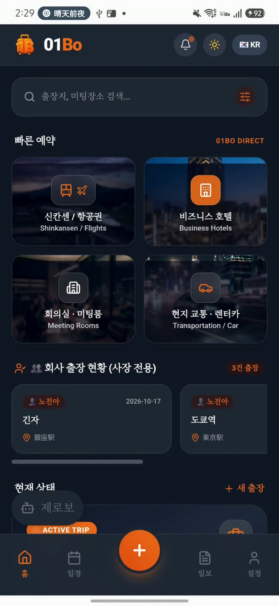 | 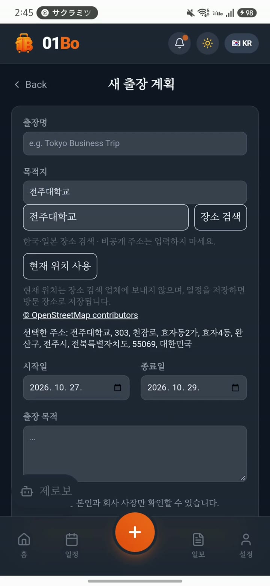 | 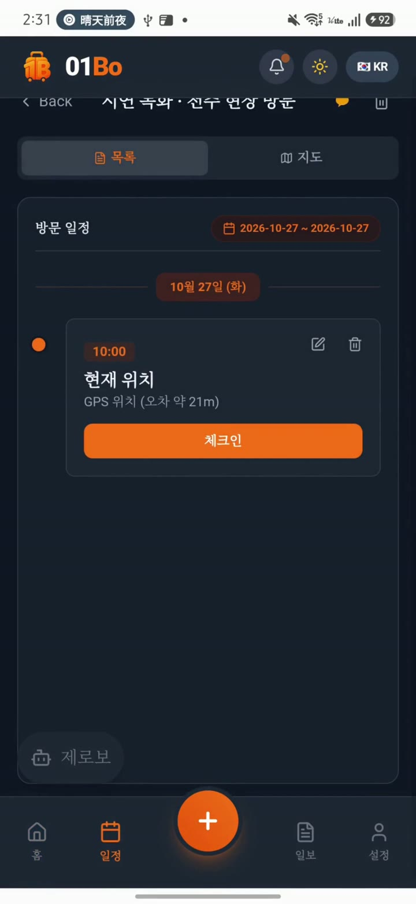 |
| 00:05 · 사장용 현황 영역 | 13:20 · 주소 후보를 일정에 사용 | 01:15 · 체크인 전 일정 |

| 제로보 일정 등록 | NFC+GPS 체크아웃 성공 | 경비 기록 |
| :---: | :---: | :---: |
| 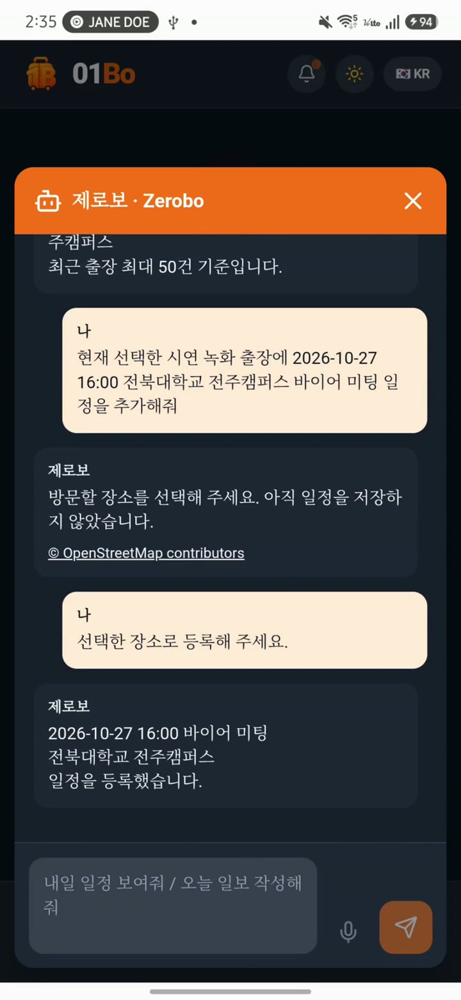 | 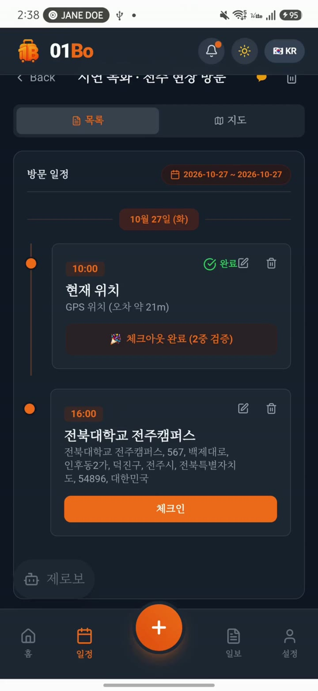 | 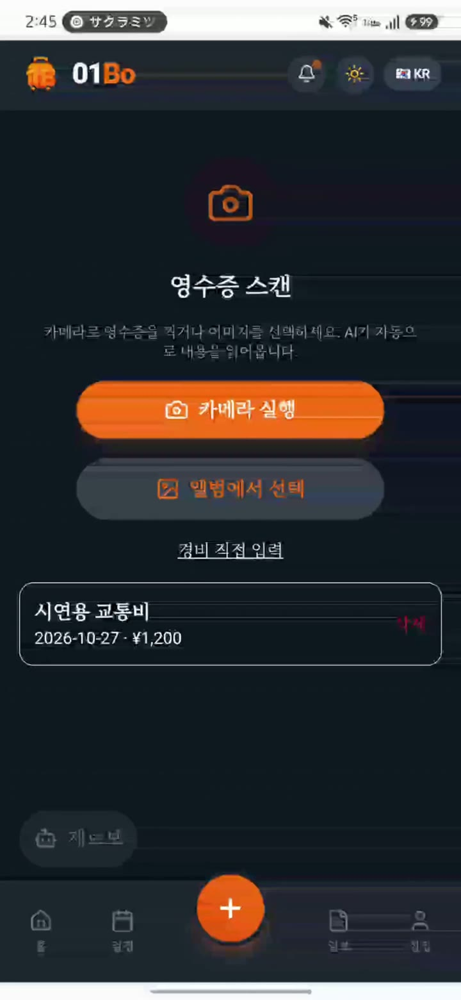 |
| 05:45 · 선택 후 등록 결과 | 08:30 · 실제 이중 검증 완료 | 14:00 · 수동 입력 경비; OCR 성공 증거 아님 |

| 직원의 회사 전체 조회 거부 | 라이트 테마 | 등록 기록 기반 일보 |
| :---: | :---: | :---: |
| 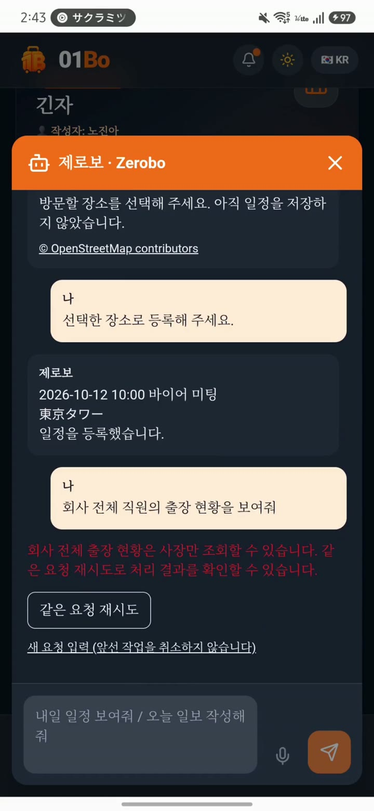 | 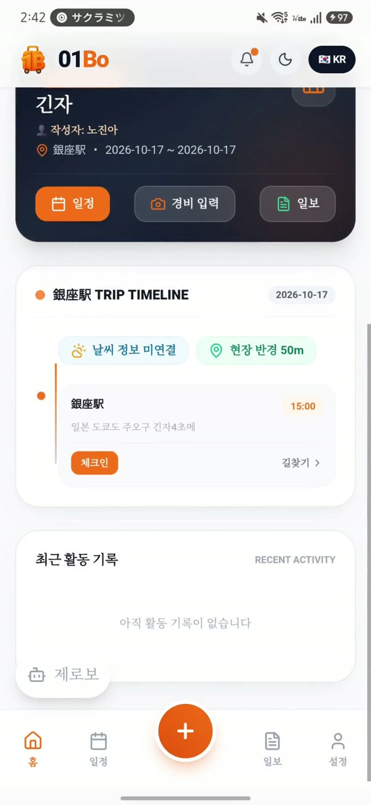 | 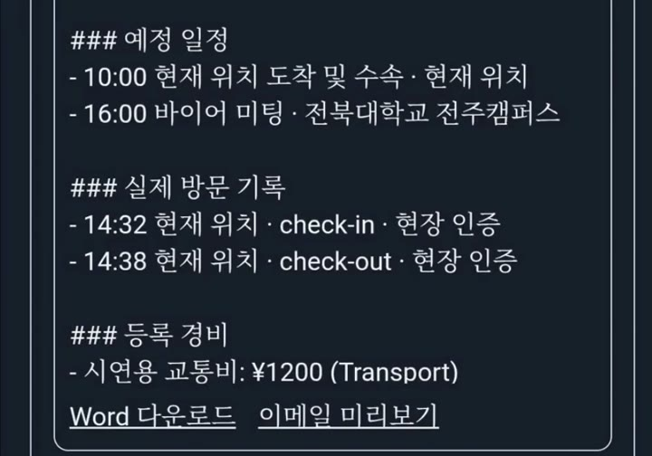 |
| 12:35 · AI 요청에도 같은 권한 적용 | 12:05 · 밝은 테마 | 10:10 · 일보 부분 발췌; 이메일 상태 부분은 제외 |

촬영 이후 미팅 시간이 16:00에서 16:30으로 변경되어, 중간 캡처와 마지막 수신 문서의 시간이 다릅니다. 전체 영상의 **14:20**에는 재연결 후 실제 Gmail 수신과 Word 첨부 확인 화면이 있습니다. 공개 영상 URL은 저장소에 등록하지 않았고 원본 영상 자체는 Git에 포함하지 않습니다. [전체 타임라인](docs/DEMO_GUIDE.md)을 참고하세요.

## 사용자와 권한

사용자는 이메일과 비밀번호로 로그인합니다. Gmail 연결은 일보를 보내기 위한 추가 연결이며, 앱 로그인과 별개입니다.

| 사용자 상태 | 가능한 작업 | 제한 |
| --- | --- | --- |
| 회사 소속이 없는 계정 | 프로필 설정, 회사 생성 또는 초대 참여 | 출장 업무 API 사용 제한 |
| 직원 `employee` | 본인 출장·일정·방문·경비·일보 관리 | 회사 전체 직원 출장 조회 불가 |
| 매니저 `manager` | 본인 업무, 코드에서 허용한 팀 생성 | 사장과 동일한 전체 조회 권한을 뜻하지 않음 |
| 사장 `admin` | 같은 회사 직원 출장·기록 조회, 회사 초대 및 NFC 정책 관리 | 다른 회사 접근 불가; 직원 출장 임의 수정 권한과 조회 권한은 별개 |

회사 코드는 소속 식별자이고, 가입에는 서버가 발급한 유효한 **초대 코드**를 사용합니다. 클라이언트에서 회사 코드나 역할을 바꿔 요청하는 것만으로 접근 권한이 생기지 않습니다. 기존 회사 소속을 설정 화면에서 임의로 다른 회사로 교체하는 흐름도 허용하지 않습니다.

## 처음부터 끝까지 사용하는 방법

### 1. 계정을 만들고 회사에 참여하기

1. 회원가입 화면에서 이름·이메일·비밀번호를 입력합니다. 현재 비밀번호 기준은 15~128자입니다.
2. 처음 회사를 만드는 사람은 회사 생성 흐름에서 회사명과 대표자명을 입력합니다. 생성 계정은 그 회사의 사장 역할이 됩니다.
3. 직원은 사장에게 받은 초대 코드를 확인하고 참여합니다. 회사 식별 코드와 초대 코드를 혼동하지 않습니다.
4. 이미 소속된 계정은 기존 회사에 남습니다. 회사 변경은 별도 관리자 처리 대상입니다.

이번 영상은 기존 사장·직원 계정으로 촬영했습니다. 신규 회사 생성·신규 회원가입 전체 성공 과정은 영상에서 검증하지 않았습니다. 테스트 계정 비밀번호나 활성 초대 코드는 README에 제공하지 않습니다.

### 2. 출장과 방문 일정을 만들기

출장은 여러 방문 일정을 담는 상위 묶음입니다. 출장명, 기간, 목적지를 정하고 방문 장소·날짜·시간을 추가합니다. 한국·일본 장소 검색 결과에서 주소를 선택하거나 휴대폰 현재 위치를 이용할 수 있습니다.

장소 검색은 검색 버튼을 눌러 실행합니다. 검색 결과가 없으면 장소의 정식 명칭과 지역명을 함께 입력합니다. 검색 요청과 지도·경로 요청은 외부 서비스에 전달되므로 비공개 주소를 검색어에 넣지 않습니다. 현재 위치를 저장하면 일정의 좌표로 사용됩니다.

### 3. 현장에서 체크인하고 체크아웃하기

위치 권한과 휴대폰 위치 기능을 켠 뒤 대상 방문 일정을 선택합니다. NFC 필수 조건을 충족하는 일정이면 등록된 태그와 위치를 함께 검증합니다. 그렇지 않은 일정은 GPS 방식이 사용됩니다. 같은 일정에서 체크인과 체크아웃의 순서가 기록됩니다.

화면에 성공 메시지가 나왔는지, 방문 기록이 저장됐는지 확인합니다. 태그를 읽었다는 사실과 서버가 현장 기록을 승인했다는 사실은 다릅니다.

### 4. 경비 기록하기

가맹점/내용, 금액, 날짜, 분류를 입력해 출장에 저장합니다. 시연에서는 교통비 1,200 JPY를 수동으로 저장했습니다. 영수증 촬영·갤러리 선택 화면도 있지만, 이번 시연에는 실제 OCR 성공 장면이 없습니다.

현재 금액 표시와 일보는 JPY 중심입니다. 한국 장소를 검색할 수 있다는 사실이 다중 통화 정산 전체 지원을 뜻하지는 않습니다. KRW 환산은 서버 설정 환율이며 실시간 시세 조회가 아닙니다.

### 5. 일보와 Word 만들기

대상 출장과 날짜를 정해 일보를 작성합니다. 현재 일보 구성은 DB에 저장된 예정 일정, 실제 체크인·체크아웃, 등록 경비를 모으는 방식입니다. AI가 없던 회의 성과나 방문을 만들어 넣는 구조로 설명하지 않습니다.

일보를 저장하고 Word 다운로드를 선택합니다. Android에서는 파일 공유 화면이 열릴 수 있으며, 공유 대상 앱 선택이나 파일 저장은 기기 UI에서 마무리합니다.

### 6. Gmail을 연결하고 보내기

1. 설정에서 Gmail 연결을 누릅니다.
2. 열린 Google 화면에서 본인 계정으로 권한을 허용합니다.
3. 앱으로 돌아와 연결 상태를 확인합니다.
4. 일보의 수신자·제목·본문·Word 첨부를 확인합니다.
5. 최종 발송 확인을 눌러 보냅니다.

`메일 서버 접수`는 전달 요청이 수락됐다는 뜻이며 수신함 도착과 동일하지 않습니다. 시연에서는 실제 수신 화면까지 별도로 확인했습니다. `결과 확인 필요`라면 자동으로 다시 보내지 말고 보낸편지함과 수신 여부부터 확인합니다.

## 제로보는 어떤 일을 하나요?

제로보는 앱 데이터에 접근하는 서버 도구를 호출하는 출장 도우미입니다. 모델이 임의 SQL이나 서버 명령을 실행하도록 제공하지 않습니다.

| 요청 예시 | 처리 흐름 |
| --- | --- |
| “내 일정 보여 줘” | 로그인 사용자가 볼 수 있는 출장 조회 |
| “선택한 출장에 오늘 16시 전북대학교 바이어 미팅 추가해 줘” | 장소 검색 → 후보 선택 → 일정 저장 |
| “그 미팅을 16시 30분으로 바꿔 줘” | 대상 일정 확인 → 시간 변경 |
| “오늘 일보 작성해 줘” | 해당 출장·날짜의 저장 기록으로 일보 생성 |
| “이 일보를 recipient@example.com으로 보내 줘” | 이메일 초안/미리보기 → 사용자 최종 확인 → 발송 |
| 직원이 “회사 전체 출장 보여 줘” | 사장 권한이 없으면 거부 |

현재 작업 유형은 `clarify`, `list_trips`, `create_event`, `update_event`, `write_report`, `send_report`입니다. 요청이 모호하면 추가 정보를 묻습니다. 화면에서 요청을 새로 입력한다고 이전에 완료한 작업이 취소되지는 않습니다.

음성 버튼과 제로보 호출 설정이 존재하지만, **이번 영상은 텍스트 입력으로 진행**했습니다. 백그라운드 호출은 기기·권한·배터리 정책에 대한 추가 검증이 필요합니다. OpenAI API 키는 서버에만 보관합니다. 프런트의 `VITE_*` 변수에 키를 넣으면 안 됩니다.

## NFC 이중 확인은 어떻게 동작하나요?

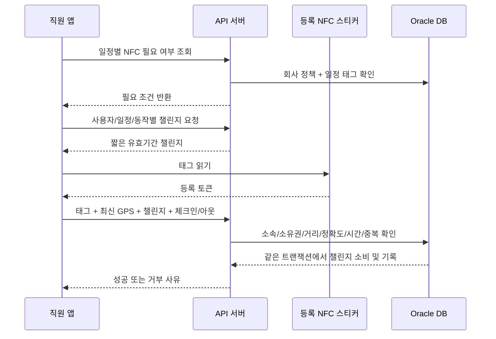

| 조건 | 현재 구현 |
| --- | --- |
| 정책 변경 | 같은 회사 사장 권한 |
| 필수 여부 | 회사 정책이 켜져 있고 해당 일정에 활성 태그가 있는 경우 |
| 태그 연결 | 회사·출장·방문 일정에 연결 |
| 거리 | 대상 좌표에서 50m 이내 |
| GPS 정확도 | 50m 이하 |
| 위치 측정 시각 | 서버 시간과 차이 60초 이내 |
| 챌린지 | 사용자·회사·출장·일정·동작에 연결, 만료/재사용 거부 |
| 기록 | `nfc_gps`, `gps`, `unverified`로 구분 |

사장이 설정에서 대상 출장·일정을 고르고 스티커를 기록·등록한 다음 정책을 켭니다. 스티커 기록은 기존 내용을 덮어씁니다. 현장에 고정된 태그를 전제로 하며, 태그를 가지고 이동하면 방문 증거의 의미가 약해집니다. 정적 태그 복제와 GPS 조작을 완전히 방지하는 기술 또는 로그인 MFA로 설명하지 않습니다.

시연에서는 **GPS 체크인 후 NFC+GPS 체크아웃**을 성공했습니다. 두 단계 모두 NFC를 사용했다고 주장하지 않습니다. [구현 상세](docs/NFC_IMPLEMENTATION.md)는 당시 기록이므로 오래된 IP와 미완료 표현은 최신 시연 현황과 구분해 읽으세요.

## 현재 기능 상태

| 기능 | 코드 상태 / 실제 확인 범위 |
| --- | --- |
| 사장·직원 로그인 및 본인/회사 출장 조회 | 기존 계정으로 실기기 확인 |
| 출장 생성·현재 위치·장소 검색 | 실기기 확인 |
| 제로보 조회·장소 선택·등록·시간 변경 | 실기기 텍스트 요청 확인 |
| 지도와 예상 도로 경로 | 실기기 확인; 실제 이동 궤적 아님 |
| GPS 체크인 | 실기기 확인 |
| NFC 기록·등록 및 NFC+GPS 체크아웃 | 초기 오류 후 재시도 성공 |
| 경비 수동 입력 | 실기기 확인 |
| 일보 저장·Word·Gmail | 재연결 후 실제 수신/첨부 확인 |
| 직원의 전체 회사 조회 제한 | 실기기 거부 확인 |
| 라이트/다크·한국어/일본어 | 화면 확인; 일부 번역 미완료 |
| 음성 인식·백그라운드 호출 | 구현/설정 존재, 이번 영상 성공 미검증 |
| 영수증 OCR | 선택 UI 확인, 실제 인식 미검증 |
| 신규 회사/가입/팀 변경/외부 예약 | 이번 영상 전체 실행 미검증 |
| 관리자 통계 | 기록이 있어도 0으로 표시되는 문제 남음 |
| 메일 상태 복원 | 채팅 재진입 때 발송 전으로 표시되는 문제 남음 |

## 전체 구성과 데이터 흐름

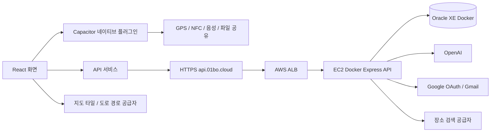

운영 DB는 확인된 구성상 EC2의 Oracle XE 컨테이너입니다. 이 프로젝트를 RDS 기반이라고 소개하지 않습니다. 네이티브 앱은 HTTPS API를 직접 사용하고, PC 개발 화면은 Vite의 `/api` 프록시를 이용합니다. 사장 현황은 조회/새로고침 기반이며 지속적인 백그라운드 추적이나 실시간 푸시가 검증된 것은 아닙니다.

백엔드의 기준 저장소는 [01BO_Server](https://github.com/hangjin01/01BO_Server)입니다. 이 프런트 저장소의 `backend/`는 앞선 작업에서 포함한 **로컬 소스 스냅샷**입니다. 서버 수정과 배포 검토는 별도 백엔드 저장소를 기준으로 진행하고 양쪽 복사본이 자동 동기화된다고 가정하지 마세요.

## 개발 환경 실행

### 준비

- Git, 프로젝트 의존성을 지원하는 Node.js와 npm. 이번 로컬 검증에는 Node 24를 사용했습니다.
- 앱을 실제 데이터와 사용하려면 접근 가능한 API, 계정, 회사 소속이 필요합니다.
- Android 빌드에는 Android SDK와 설치된 Gradle/Android 플러그인이 요구하는 JDK가 추가로 필요합니다.

```bash
git clone https://github.com/hangjin01/01BO.git
cd 01BO
npm ci
npm run dev
```

브라우저에서 `http://localhost:5173`을 엽니다. 이 주소는 PC 개발 서버입니다. 휴대폰에서 `localhost`는 휴대폰 자신을 뜻하므로 APK의 API 주소로 사용할 수 없습니다.

| 파일/설정 | 값과 의미 |
| --- | --- |
| `.env.development` | `VITE_API_BASE_URL=/api` |
| `vite.config.ts` | `/api`를 `https://api.01bo.cloud`로 프록시 |
| `.env.production` | `VITE_API_BASE_URL=https://api.01bo.cloud/api` |
| `services/apiService.ts` | JSON 요청·오류 처리·네이티브 세션 첨부 |
| `services/nativeSession.ts` | 네이티브 세션 저장/복구 |

환경변수를 바꾼 뒤 개발 서버를 다시 시작합니다. APK에는 빌드 당시 값이 들어가므로 값을 변경한 뒤 다시 빌드·동기화해야 합니다. 개발 화면도 기본적으로 실제 API를 사용하므로 테스트용 계정을 사용하세요. 실행만으로 테스트 데이터가 자동 생성되지는 않습니다.

## Android APK 빌드

```bash
npm run typecheck
npm run build
npx cap sync android
cd android
./gradlew assembleDebug
```

현재 Gradle 설정은 `versionName=0.32`, `versionCode=7`, `minSdk=24`, `compileSdk=36`, `targetSdk=36`입니다. 산출물 이름은 `01bo-v0.32.apk`이며 일반적인 debug 출력 경로는 `android/app/build/outputs/apk/debug/01bo-v0.32.apk`입니다. Debug APK를 스토어용 서명 릴리즈로 설명하지 않습니다.

백그라운드 호출까지 빌드하려면 저장소에서 제외된 한국어 Vosk 모델을 준비합니다.

```bash
python3 scripts/prepare-wake-model.py
```

스크립트는 지정한 모델을 다운로드하고 SHA-256을 검증합니다. 모델 준비 완료가 실제 휴대폰의 백그라운드 호출 성공을 보장하지는 않습니다. API 키와 Gmail 비밀키는 APK에 포함하지 않습니다. NFC·위치·마이크 권한, Android 배터리 제한 및 실제 스티커 테스트는 별도로 확인해야 합니다.

사용자 지정 버전 규칙은 큰 변경 `0.1 → 0.2`, 작은 변경 `0.1 → 0.11`, 버그 수정 `0.11 → 0.111`입니다. Android `versionCode`는 이 표기와 별도로 항상 증가시킵니다. 정식 출시는 `v1.0`입니다.

## 소스 구조

| 경로 | 역할 / 변경할 때 보는 곳 |
| --- | --- |
| `App.tsx` | 로그인 상태, 화면 전환, 주요 앱 데이터 흐름 |
| `components/views/` | 홈·일정·출장 생성·관리자·설정·스캐너 화면 |
| `components/AIChatModal.tsx` | 제로보 대화와 도구 결과 UI |
| `components/DailyReportTools.tsx` | 일보 관련 작업 UI |
| `components/GmailConnect.tsx` | Gmail 연결 상태와 OAuth 시작 |
| `components/PlaceSearch.tsx`, `TripMap.tsx` | 장소 후보 및 지도 표시 |
| `components/NfcSettings.tsx` | 회사 NFC 정책·태그 등록 |
| `components/ZeroboWakeSettings.tsx` | 제로보 호출 설정 |
| `services/apiService.ts` | API 요청·응답 및 파일 다운로드 |
| `services/locationService.ts`, `routeService.ts` | 위치·도로 경로 |
| `services/nfcService.ts`, `nfcVerification.ts` | 태그 처리 및 현장 검증 순서 |
| `services/receiptCamera.ts` | 네이티브 카메라/이미지 선택 |
| `services/speechService.ts`, `wakeService.ts` | 음성·호출 연결 |
| `android/app/src/main/java/com/company/o1bo/` | NFC·음성·호출 네이티브 구현 |
| `public/brand/`, `android/app/src/main/res/` | 로고·런처·스플래시 |
| `tests/` | 회귀·NFC·경로·카메라 검사 |
| `scripts/` | 운영 연결 및 비밀값 숨김 입력 보조 도구 |
| `docs/` | 시연 증거, 구현/릴리즈/작업 재개 기록 |

## 검증 방법

```bash
npm run typecheck
npm test
node tests/nfc-verification.mjs
node tests/road-route.mjs
npm run test:camera
npm run build
```

2026-11-01 소스 반영 시 타입 검사, 프런트 회귀, NFC·경로·카메라 테스트와 Vite 빌드가 통과했습니다. 카메라 테스트는 모의 네이티브 API입니다. Vite의 혼합 import와 큰 청크 경고는 남아 있습니다. 이 README 작성 작업은 문서·캡처 변경이며 신규 APK를 빌드하거나 기능 검증을 다시 수행한 작업이 아닙니다.

## 문제 해결

| 증상 | 먼저 확인할 항목 |
| --- | --- |
| 서버 처리 실패 / 초기 로딩 실패 | API `/health`, `/api/health`, 세션, 서버 DB 준비 상태를 구분 |
| PC에서는 되는데 APK는 연결 안 됨 | 빌드 환경의 HTTPS API 주소, `cap sync`, CORS, 새 APK 설치 여부 |
| Gmail `redirect_uri_mismatch` | Google 웹 클라이언트 승인 URI와 서버 콜백이 정확히 일치하는지 |
| Gmail `invalid_grant` | 앱에서 Gmail 재연결; 서버 암호화 키 임의 변경 금지 |
| 메일 결과 확인 필요 | 보낸편지함/수신 여부 확인 후 판단; 반복 발송 금지 |
| 지도/장소 검색이 안 뜸 | 인터넷, 좌표 저장, 공급자 설정, 검색 요청 제한; 지도와 검색은 별개 |
| NFC에서 MIME 이름만 보임 | 설치 앱의 태그 처리·NFC 설정·등록 상태 확인; 시스템 태그 화면은 서버 검증 성공이 아님 |
| NFC 거리/정확도 오류 | 정확한 위치 권한, 실외 GPS, 등록 장소·챌린지 만료 확인 |
| 음성 입력 실패 | 마이크 권한·기기 인식 서비스·호출 설정 확인; 실기기 추가 검증 대상 |
| 회사 전체 조회 불가 | 사장 계정인지 확인; 직원에게는 정상적인 권한 제한 |

## 남은 작업과 문서

다음 항목은 운영 준비 과정에서 계속 검증·수정해야 합니다.

- 관리자 통계의 방문·경비 반영 오류
- 발송한 이메일의 채팅 재진입 상태 복원
- 일본어 UI 잔여 문구
- 실제 영수증 OCR 및 음성·백그라운드 호출
- 신규 사용자 온보딩 전체 회귀, 다양한 기기와 권한 거부 시나리오
- 백엔드 의존성 취약점과 초기 배포 구성 정비
- 릴리즈 서명·배포·백업/복구 등 운영 절차

| 문서 | 목적 |
| --- | --- |
| [시연 가이드](docs/DEMO_GUIDE.md) | 기능별 영상 시각, 캡처 출처, 검증 한계 |
| [v0.32 릴리즈](docs/RELEASE_v0.32.md) | 누적 변경 요약 |
| [작업 재개 기록](docs/RESUME_CHECKPOINT.md) | 작업 순서와 당시 상태; 날짜별 기록 |
| [NFC 구현](docs/NFC_IMPLEMENTATION.md) | 현장 확인 규칙과 초기 구현 배경 |
| [백그라운드 호출 계획](docs/ZEROBO_BACKGROUND_VOICE_PLAN.md) | 음성 호출 관련 설계/제약 |
| [백엔드 README](https://github.com/hangjin01/01BO_Server) | API·DB·인증·메일·환경 설정 |

과거 문서는 작성 당시의 스냅샷입니다. 이전 IP, Gemini 표현, 미검증 상태가 남아 있으면 날짜와 현재 소스를 함께 확인하세요. 계정 비밀번호, API 키, OAuth 비밀키, 서명키, 활성 초대 코드, 실제 사용자 데이터는 이슈·PR·README에 올리지 않습니다.
